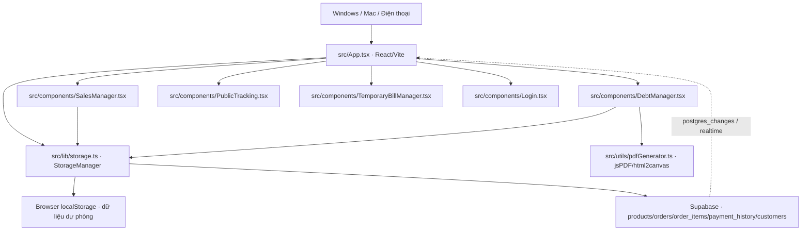

# Bản đồ kiến trúc QUANLYKO-OK

> Baseline: nhánh `fix/cross-device-consistency-audit`, commit `1cdd777` (24/10/2026). Đây là sơ đồ từ mã nguồn đã đọc, **không phải kết quả chạy Archify**. Các phần chưa kiểm chứng được ghi rõ.

## Kiến trúc ứng dụng

## Các điểm neo trong code

| Thành phần | Đường dẫn / hàm | Vai trò đã kiểm tra |
| --- | --- | --- |
| Khởi động và nhận realtime | [src/App.tsx](../../src/App.tsx) · `initData`, `postgres_changes` | Tải dữ liệu khi mở ứng dụng; nhận thông báo thay đổi Supabase |
| Đơn hàng | [src/lib/storage.ts](../../src/lib/storage.ts) · `addOrder`, `updateOrder`, `deleteOrder` | Ghi local và thao tác Supabase |
| Thu tiền | [src/lib/storage.ts](../../src/lib/storage.ts) · `recordCustomerPayment` | Ghi `payment_history` rồi phân bổ FIFO vào đơn |
| Hủy thu tiền | [src/lib/storage.ts](../../src/lib/storage.ts) · `deletePaymentAndRecalculate` | Xóa lịch sử, tính lại phân bổ |
| Đồng bộ | [src/lib/storage.ts](../../src/lib/storage.ts) · `syncAllDataFromSupabase` | Tải và gộp dữ liệu cloud/local |
| Kiểm toán PET | [src/lib/storage.ts](../../src/lib/storage.ts) · `inspectDtfDebtSync` | So sánh đơn, số tiền, lịch sử thu tiền; chỉ đọc |
| Giao diện công nợ | [src/components/DebtManager.tsx](../../src/components/DebtManager.tsx) | Thu tiền, đối chiếu và xuất báo cáo |
| PDF | [src/utils/pdfGenerator.ts](../../src/utils/pdfGenerator.ts) · `generateReconciliationPDF` | Xuất đối soát PDF |

## Ranh giới xác minh

- Đã đọc trực tiếp: `package.json`, `App.tsx`, `storage.ts`, `DebtManager.tsx`, `pdfGenerator.ts`.
- Chưa xác minh runtime: quyền RLS, trigger database, cấu hình publication realtime, hành vi thiết bị thực tế và kết quả build.
- `localStorage` là bộ nhớ **riêng từng trình duyệt**. Sơ đồ không ngụ ý các máy chia sẻ bộ nhớ local.
- Không coi Supabase là nguồn duy nhất cho mọi dữ liệu ở **hiện trạng**: code hiện vẫn giữ và gộp dữ liệu local.
- Sơ đồ Mermaid là nguồn có thể sửa và xem ngay trên GitHub; Archify HTML tương tác cần chạy CLI/skill trên checkout có Node/Claude Code.

## Quy trình khi thay đổi mã nguồn

1. Đọc sơ đồ và truy theo các đường dẫn nguồn.
2. Xác định bảng Supabase, localStorage, các màn hình và báo cáo bị ảnh hưởng.
3. Kiểm tra giao dịch, retry, mất mạng, hai thiết bị cùng ghi và khả năng trùng lặp.
4. Không xóa local backup, không tự đồng bộ cưỡng bức, không sửa dữ liệu thật khi kiểm thử.
5. Chạy `npm run lint`, `npm run build`, thử nghiệp vụ trên nhánh riêng.
6. Cập nhật sơ đồ cùng pull request và đánh dấu phần nào mới được kiểm chứng.
