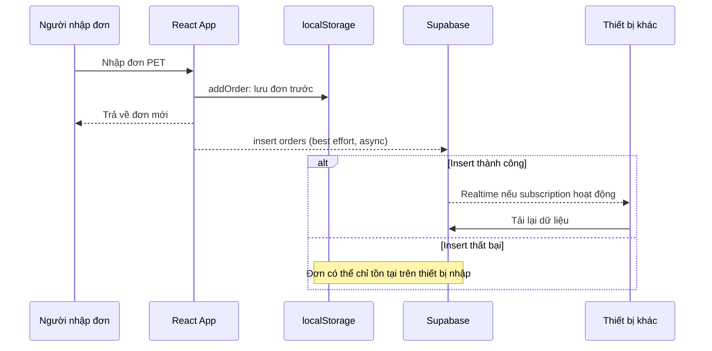
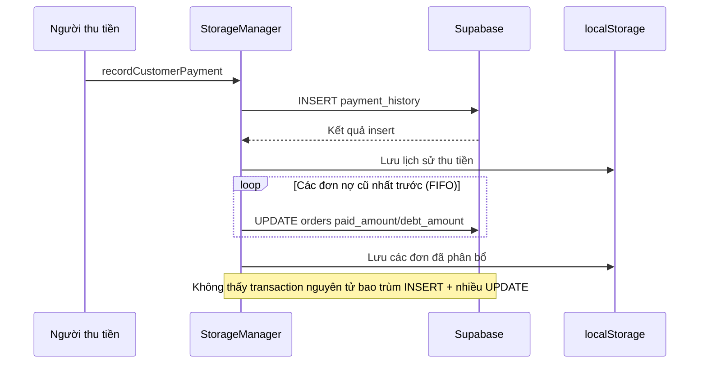
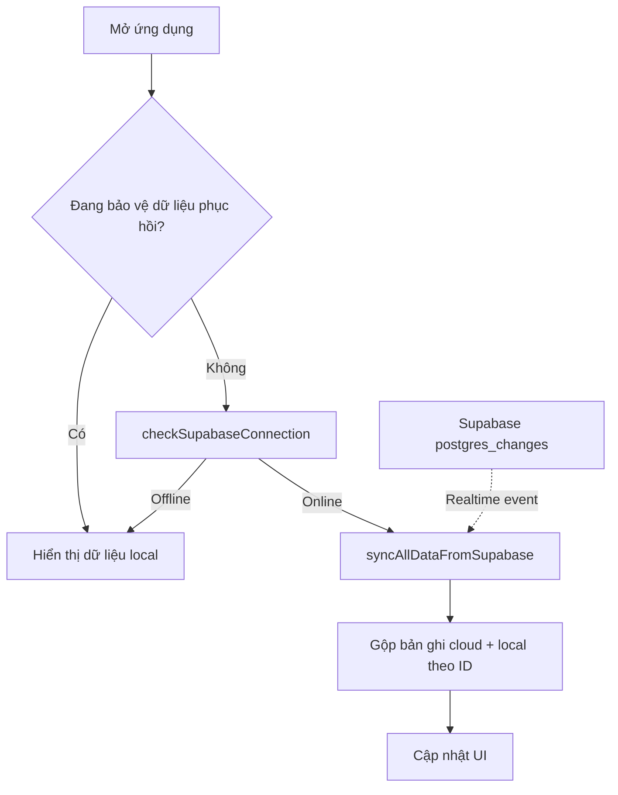

# Luồng nghiệp vụ và các rủi ro đồng bộ

> Luồng **hiện có** dựa trên `src/App.tsx` và `src/lib/storage.ts`. Mũi tên nét đứt là sự kiện bất đồng bộ, không phải bảo đảm thành công.

## 1. Nhập đơn PET hiện tại



## 2. Thu tiền khách hiện tại



## 3. Tải dữ liệu và realtime hiện tại



## 4. Luồng mục tiêu trong tương lai (CHƯA TRIỂN KHAI)

```mermaid
sequenceDiagram
  participant Client as Thiết bị
  participant API as RPC / Transaction server
  participant DB as Supabase
  Client->>API: Gửi mutation với idempotency key + version
  API->>DB: Transaction nguyên tử, kiểm tra version
  alt Thành công
    DB-->>API: Commit
    API-->>Client: Xác nhận phiên bản và số dư mới
  else Mất mạng / conflict
    API-->>Client: Chưa xác nhận hoặc xung đột
    Note over Client: Không coi là đã đồng bộ; giữ dữ liệu chờ xử lý
  end
```

## 5. Quy tắc kiểm thử khi sửa

- Nhập một đơn trên Windows, kiểm tra Mac/điện thoại chỉ sau khi server xác nhận.
- Gửi lại cùng một yêu cầu tạo đơn / thu tiền: không được nhân đôi.
- Mất mạng trước, trong, sau lúc ghi: trạng thái chưa đồng bộ phải minh bạch.
- Hai thiết bị cùng sửa một đơn: phải phát hiện conflict, không âm thầm ghi đè.
- Thu tiền và phân bổ nợ: hoặc toàn bộ thành công, hoặc toàn bộ rollback.
- Khôi phục kết nối và quay lại tab: dữ liệu phải được làm mới, không tự xóa đơn local-only.
- Đối chiếu tổng tiền hàng, tiền thu và dư nợ trên các thiết bị.

## 6. Công cụ Archify

Skill tham khảo: [tt-a1i/archify](https://github.com/tt-a1i/archify). Chưa cài hoặc chạy skill trong repository từ phiên này. Khi chạy tại máy phát triển, dùng bản đồ này làm cơ sở, yêu cầu Archify kiểm chứng từng cạnh với file/hàm nguồn rồi sinh HTML trong `docs/architecture`; không cho phép skill sửa nghiệp vụ.
